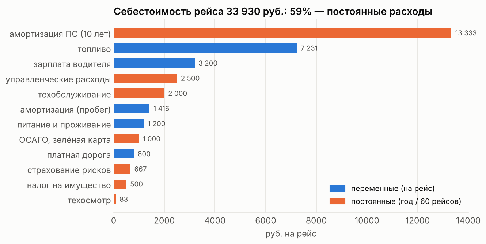
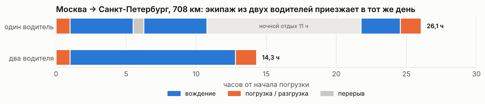

### 🚚 планирование доставки · delivery planning

считаю логистику одной поставки от начала до конца: сколько заказывать, на чём везти, по какой дороге, сколько стоит рейс, какой ставить тариф и когда груз приедет с учётом отдыха водителя. каждый расчёт оформлен функцией, так что его можно переиспользовать с другими цифрами
*end-to-end logistics for one shipment: order size, vehicle, route, trip cost, tariff and arrival time with driver rest rules. every calculation is a reusable function*

`python` `pandas` `matplotlib` `eoq` `mcda` `cost modeling` `scheduling`

📓 [открыть ноутбук · open the notebook](logistics_planning.ipynb)

---

**кейс** · *the case*

доставить комплект спортинвентаря (850 кг, 12,5 м³) со склада в люберцах в школу в санкт-петербурге, 708 км
*ship a set of sports equipment (850 kg, 12.5 m³) from a warehouse near moscow to a school in st. petersburg, 708 km*

---

**что нашла** · *key findings*

**1. рейс стоит ≈ 33 900 руб., и 59% этого постоянные расходы**
самая большая статья это амортизация фуры, а не топливо. при наценке 35% тариф ≈ 45 800 руб., прибыль ≈ 11 900 с рейса
*the trip costs ≈ 33,900 rub and 59% of it is fixed costs; depreciation of the truck outweighs fuel. a 35% markup gives a ≈ 45,800 rub tariff*



**2. фура едет почти пустой**
груз занимает 3,5% грузоподъёмности и 14% объёма полуприцепа. для такой партии выгоднее фургон или догрузка попутными грузами, и это главный резерв экономии
*the cargo uses 3.5% of the trailer's payload and 14% of its volume, so a van or consolidated loads would save the most*

**3. два водителя довозят груз в тот же день**
по правилам ес 561/2006 один водитель едет не больше 9 ч в сутки, поэтому ему нужна ночёвка, и путь занимает ≈ 26 ч. экипаж из двух водителей сменяет друг друга и доезжает за ≈ 14 ч. для расчёта написала функцию, которая строит расписание по этим правилам
*under eu 561/2006 a solo driver needs an overnight rest, ≈ 26 h in total; a two-driver crew arrives in ≈ 14 h. a function builds the schedule from the rules*



**4. выбор техники и маршрута**
тягач man tgx и изотермический полуприцеп выиграли по взвешенным оценкам, маршрут по м10 короче на 52 км и дешевле
*man tgx and an insulated trailer won the weighted scoring; the m10 route is 52 km shorter and cheaper*

---

**что внутри** · *what's inside*

| шаг · step | метод · method |
|---|---|
| размер заказа · order size | eoq |
| выбор тягача и полуприцепа · vehicle choice | взвешенные оценки · weighted scoring |
| маршрут · route | сравнение затрат · cost comparison |
| использование фуры · vehicle utilization | объёмная грузоподъёмность, коэффициент использования массы |
| топливо · fuel | нормативный расход с надбавкой за груз |
| себестоимость и тариф · cost & tariff | переменные + постоянные затраты на рейс |
| время доставки · delivery time | расписание по ес 561/2006 · rule-based scheduler |
| сверка · cross-check | 22 показателя курсовой против пересчёта |

при сверке нашлись ошибки в исходной курсовой: eoq для двух категорий, суммы баллов тягачей, расход при полной загрузке и график доставки. выбор техники, маршрута и тариф от них не меняется, все расхождения разобраны в ноутбуке
*the cross-check found errors in the original coursework (two eoq values, scoring sums, full-load fuel, the schedule). they don't change the decisions; each one is explained in the notebook*

---

**как запустить** · *how to run*

```bash
pip install -r requirements.txt
jupyter notebook logistics_planning.ipynb
```

все данные в ноутбуке, отдельные файлы не нужны
*all data lives in the notebook*

---

курсовая работа по дисциплине «логистические системы», мтуси, 2025
*coursework for the logistics systems course, mtuci, 2025*
